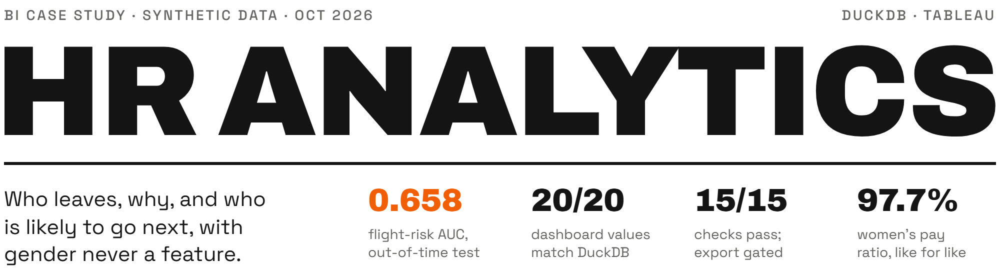
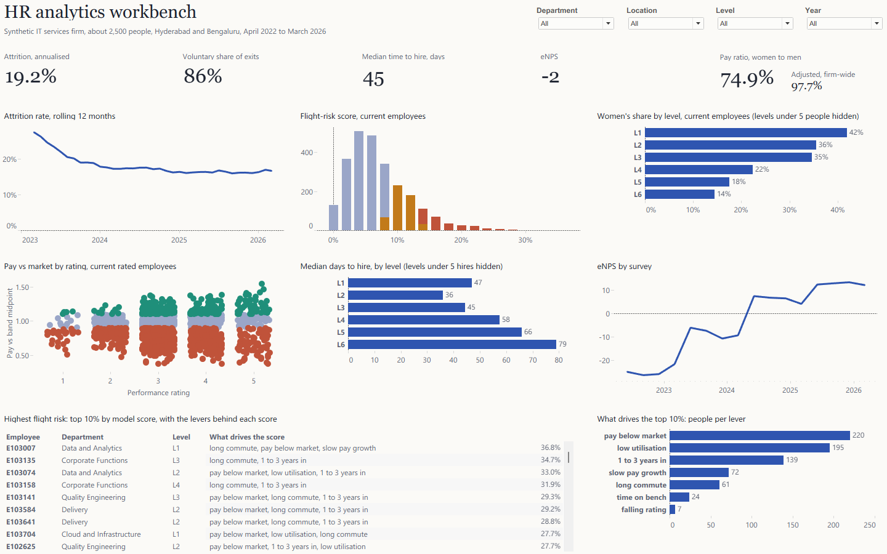

<picture>
  <source media="(max-width: 600px) and (prefers-color-scheme: dark)" srcset=".github/assets/header-phone-dark.png">
  <source media="(max-width: 600px) and (prefers-color-scheme: light)" srcset=".github/assets/header-phone-light.png">
  <source media="(prefers-color-scheme: dark)" srcset=".github/assets/header-dark.png">
  <source media="(prefers-color-scheme: light)" srcset=".github/assets/header-light.png">
  
</picture>

An end-to-end people-analytics case study: four years of synthetic HR records for an Indian IT services firm, modelled and tested in DuckDB, with a flight-risk model held to a fairness check. The Tableau workbench is generated entirely from code, so every view can be rebuilt and every number checked against the database.

[Live dashboard](https://public.tableau.com/app/profile/daman.reddy/viz/HRAnalyticsWorkbench/Workbench) · [Case study (PDF)](docs/case-study.pdf) · [Portfolio page](https://damanjz.github.io/portfolio/projects/hr-analytics/)

## Results

| Figure | Result | How it is produced |
|---|---|---|
| Flight-risk model, out-of-time test | ROC AUC 0.658; its top 10% of scores catch 20.4% of leavers | Gradient boosting in `src/model.py`, trained on snapshots to September 2023, tested from March 2024; `data/model/model_metrics.csv` |
| Dashboard values vs DuckDB | 20 of 20 match | Five KPIs for the whole firm and three filtered views, compared with `tableau/filter_check.py`; table below |
| Checks | 15 of 15 pass; the export is blocked if any fails | `sql/checks.sql`, run by `src/pipeline.py`; each check was also run against data broken on purpose and caught it |
| Women's pay ratio, like for like | 97.7% (95% interval 96.1% to 99.3%); 74.9% raw | Regression on log pay controlling for level, department, location, rating and tenure; `data/model/pay_equity.csv` |
| Determinism | three consecutive runs byte-identical | [Case study](docs/case-study.pdf), "Same answer every run" |

| View | Attrition | Voluntary share | Days to hire | eNPS | Pay ratio |
|---|---|---|---|---|---|
| Whole firm | 19.2% | 86% | 45 | −2 | 74.9% |
| Data and Analytics | 22.3% | 91% | 50 | −3 | 73.1% |
| Bengaluru, FY 2024-25 | 17.2% | 88% | 45 | 6 | 67.5% |
| Senior levels, FY 2022-23 | 15.2% | 91% | 70 | −23 | 90.9% |

Source: [case study](docs/case-study.pdf), "Dashboard matches source": all 20 values identical in Tableau and DuckDB.

## How it works

| Stage | What happens |
|---|---|
| Generate | A seeded month-by-month simulation writes 9 HRIS, ATS, timesheet and survey exports |
| Model | DuckDB SQL builds a monthly employee snapshot with every attribute as of month end (point-in-time ASOF joins) |
| Features and ML | Quarterly snapshots, a six-month resignation label, then the flight-risk model with calibration, fairness checks, per-person drivers and a pay-equity regression |
| Marts and checks | Report tables, rolling 12-month rates and one long table for Tableau; 15 checks gate the export of 12 tables |
| Workbook | `tableau/build_twb.py` writes the Tableau workbook (.twbx with a Hyper extract) from the schema |

Reviewing the code? Start with [How it works](docs/how-it-works.pdf), a stage-by-stage guide with the design choices worth challenging. The case study is also a [web page](docs/case-study.html).

## What it answers



| Question | Where |
|---|---|
| How fast are we losing people, and is it getting better? | Attrition KPI, rolling 12-month attrition trend |
| Which leavers hurt? | Voluntary share, regretted exits (case study) |
| Are we paying fairly? | Raw and adjusted pay ratio, pay against band by rating, women's share by level |
| How long does hiring take? | Median days to hire, by level |
| How do people feel? | eNPS by survey |
| Who is likely to go next, and why? | Flight-risk distribution, top 10% with their levers, people per lever |

Four filters (department, location, level, year) drive every view.

## Findings

From the synthetic company:

- Attrition fell from 27.6% (FY 2022-23) to 16.8% (FY 2025-26).
- "Better pay" is the top resignation reason (507 of 1,467); a third of employees are paid below their market band.
- Of the 253 people in the top 10% of flight risk, 220 are paid below market and 195 have low utilisation.
- Women earn 74.9% of men's median pay, 97.7% like for like (95% interval 96.1% to 99.3%): most of the gap is that few women reach senior levels.
- eNPS rose from −25 to +13 over the four years.
- The flight-risk model (gradient boosting, out-of-time test) reaches ROC AUC 0.658; its top 10% of scores catch 20.4% of leavers.

## Data

All data is synthetic: the company, its people, salaries and survey responses are generated. Gender, age, home region and university tier are never model features; caste and religion are not modelled at all. No real employee data is used.

## Rebuild

Requirements: Python 3.12+, Tableau Public 2026.2 (free; Windows tested), about 640 MB of disk including the Python environment. The three build scripts run in about 30 seconds (measured 2026-10-12 on Windows; the rebuilt tables match the committed ones).

```bash
python -m venv .venv
.venv/Scripts/pip install -r requirements.txt
.venv/Scripts/python src/generate.py
.venv/Scripts/python src/pipeline.py
.venv/Scripts/python tableau/build_twb.py
```

Then open `tableau/HR Analytics Workbench.twbx` in Tableau Public. The data travels inside the file.

## Repo layout

```
src/generate.py          seeded generator: 9 HRIS, ATS, timesheet and survey exports
sql/01_staging.sql       typed staging
sql/02_model.sql         month and employee dimensions, monthly employee snapshot (point-in-time ASOF joins)
sql/03_features.sql      quarterly model snapshots, six-month resignation label, feature list
src/model.py             flight-risk model, calibration, fairness, drivers, pay-equity regression
sql/04_marts.sql         report tables, rolling 12-month rates, one long table for Tableau
sql/checks.sql           15 checks; the export is blocked if any fails
src/pipeline.py          builds DuckDB, trains the model, runs the checks, exports 12 tables to data/model
tableau/build_twb.py     generates the Tableau workbook (.twbx with a Hyper extract) from the schema
tableau/filter_check.py  expected dashboard numbers for any filter combination, computed in DuckDB
tableau/*.ps1            open, capture and crop helpers for Tableau Public
tableau/schema/          Tableau's published workbook schema, used by tableau/validate_twb.py
data/                    generated raw exports and the 12 exported tables
docs/                    case study and reviewer guide (HTML and PDF), dashboard images
```

## Limits

- The firm, its people and the market are synthetic; tax and benefits aren't modelled.
- Time to hire counts only filled requisitions, so the latest year looks faster than it is.
- The model was trained on the 2022 resignation wave and over-predicts the calmer years after it, so risk is shown as a rank, not a probability.
- The lever chart shows counts; a share would need a Tableau table calculation.
- The workbook is tested on Tableau Public 2026.2.2 for Windows only.

## Licence

MIT, see [LICENSE](LICENSE). `tableau/schema/` is Tableau's document schema under its own Apache 2.0 licence.
